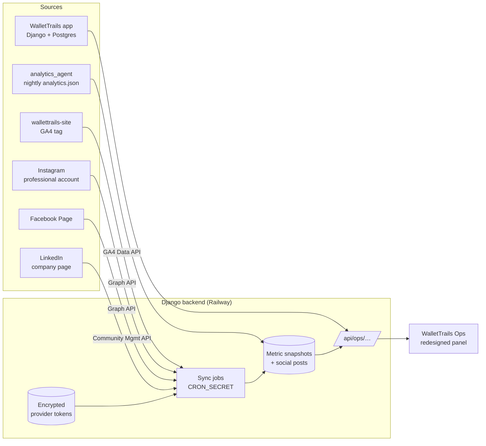

# WalletTrails Ops — admin panel redesign and ecosystem plan

This document is the research and build plan for turning `frontend-admin` (WalletTrails Ops) from a set of plain admin pages into one control centre for the whole WalletTrails ecosystem:

- the **mobile app** (users, premium, push, support, ads config — already there),
- the **marketing website** (`wallettrails-site`, via Google Analytics 4),
- the **social pages** (Instagram, Facebook, LinkedIn),
- the **nightly analytics report** (`analytics_agent`, already producing `analytics.json`).

It is written so each build phase can be picked up on its own and shipped without breaking the panel that exists today.

---


## 1. Where the admin panel is today

What exists, based on the code in this repo:


| Area         | Today                                                                                                                                                                      |
| ------------ | -------------------------------------------------------------------------------------------------------------------------------------------------------------------------- |
| Stack        | Vite 5, React 18, TypeScript, React Router 6, axios. No UI library, no chart library, no data-fetching library.                                                            |
| Styling      | One hand-written `src/styles.css` (~430 lines), dark teal theme, `Segoe UI` font.                                                                                          |
| Pages        | Login, Dashboard, Users, User detail, Premium, Promos, Notifications (campaigns), Campaign detail, Ads & Config, Support, Support detail, Audit.                           |
| Backend      | Django REST endpoints under `/api/ops/…` in `backend/api/ops_api.py`, `ops_campaigns_api.py`, `support_api.py`, `premium_api.py`, `phase5_api.py`, `remote_config_api.py`. |
| Access       | `IsOpsStaff` — any active user with `is_staff=True`. No roles beyond that.                                                                                                 |
| Audit        | `AdminAuditLog` model + `log_ops_action()` records staff actions.                                                                                                          |
| Jobs         | Scheduled work is triggered via `/api/jobs/…` endpoints protected by `CRON_SECRET`.                                                                                        |
| Privacy rule | Ops shows **counts only** — never balances, transactions, categories, or household ledgers. This rule stays in the redesign.                                               |


### What holds it back

1. **The dashboard is a flat grid of 14 numbers.** No trend, no comparison to last week, no charts, so nothing tells you whether things are getting better or worse.
2. **No design system.** Buttons, cards, tables and badges are restyled page by page; spacing and type sizes drift.
3. **It does not look like WalletTrails.** The website uses Outfit + DM Sans and a fresh green/mint palette; Ops uses a dark teal theme with system fonts.
4. **Each page fetches by hand** with `useEffect` + `useState`, so there is no caching, no background refresh, and loading/error states are inconsistent.
5. **One role for everyone.** Every staff user can delete users, send push to everyone, and change ads config.
6. **No place for the outside world.** Website traffic, social growth, and the nightly analytics report live in separate tools.
7. **Small-screen layout is a squeezed sidebar**, not a real mobile layout.

---


## 2. The ecosystem we are building




**The core rule:** the browser never talks to Google, Meta or LinkedIn directly. The Django backend holds the credentials, pulls the numbers on a schedule, stores daily snapshots, and the Ops panel reads only from `/api/ops/…`. That keeps tokens off staff laptops, avoids rate limits (one sync instead of one call per page load), and gives us history even when a platform only returns recent data.

**The loop this unlocks:** a social post links to the site with UTM tags → GA4 shows the visit and the "Get the app" click → the app shows the new sign-up. Ops is the one place where that whole funnel is visible.

---


## 3. Research — connecting each platform


### 3.1 Google Analytics 4 (website)

**Step one is on the website, not in Ops:** `wallettrails-site` currently has **no analytics tag**. Before Ops can show anything:

1. Create a GA4 property and web data stream for the site's domain; note the Measurement ID (`G-XXXX`) and the numeric Property ID.
2. Add the `gtag.js` snippet to `wallettrails-site/index.html`, reading the ID from `VITE_GA_MEASUREMENT_ID` so preview builds can send nothing.
3. Send a few custom events that matter to us: `get_app_click` (every "Get the app" / Play Store button), `use_case_tab` (which persona tab was opened), `faq_open`, `support_click`.
4. Respect consent: use Google Consent Mode v2 with analytics storage denied until the visitor accepts a small banner. Pakistan has no strict cookie law today, but EU/UK visitors do, and a banner is cheap insurance.

**Reading the data into Ops** — Google Analytics Data API v1 (`runReport`, `runRealtimeReport`):

- Create a Google Cloud project, enable the *Google Analytics Data API*, create a **service account**, download its JSON key.
- In GA4 → Admin → Property access, add the service account's email as **Viewer**. Read-only is all we need.
- Backend uses the official Python client `google-analytics-data` (`BetaAnalyticsDataClient`), credentials from an env var — never committed.
- Quotas (standard property): 200,000 core tokens/day, 40,000/hour, 14,000 per project per property per hour, 10 concurrent requests. One nightly sync plus a cached "today" call every 15 minutes is far below this.

**What Ops will show:** users, new users, sessions, engaged sessions, engagement rate, average engagement time, top pages, traffic source/medium (including our UTM campaigns), country, device, and our custom events — especially `get_app_click` as the site's main conversion. A small "right now" card can use the realtime report.

### 3.2 Meta — Instagram and Facebook

Both go through one **Meta developer app** and the Graph API.

**Account requirements**

- Instagram must be a **Professional (Business or Creator) account**. For the "Instagram API with Facebook Login" path it must be **linked to the WalletTrails Facebook Page**; this path gives Facebook and Instagram in one connection, so it is the one we want.
- The person connecting must have full control of the Page in Meta Business Suite.

**Permissions to request** (check the current names in the app dashboard before building):

- Reading: `pages_show_list`, `pages_read_engagement`, `read_insights`, `instagram_basic`, `instagram_manage_insights`, `business_management`.
- Publishing (later phase only): `pages_manage_posts`, `instagram_content_publish`.

**Tokens**

- Best option for an internal tool: a **System User** in Meta Business Manager, assigned to the Page and Instagram account, with a generated token. It belongs to the business, not to a person, so it does not break when someone leaves or changes their password.
- Fallback: an admin logs in through OAuth → exchange for a long-lived user token (~60 days) → derive the Page token. Ops must then warn before expiry and offer a "Reconnect" button.
- App Review / Advanced Access: for an app that only reads WalletTrails' *own* Page and account, development mode with app roles may be enough; publishing and anything beyond our own assets will need App Review and Business Verification. **Confirm in the Meta app dashboard before Phase 5.**

**Metrics — use the new names.** Meta has retired "impressions" in favour of **views**:

- Instagram: `impressions` is deprecated for media created after 2 July 2024; plays/replays metrics were removed from v22. Use `views`, `reach`, `likes`, `comments`, `shares`, `saved`, `total_interactions`, `profile_visits`, `follows`, plus `ig_reels_avg_watch_time` for reels.
- Facebook Page: impressions and "page fans" metrics were deprecated from 15 November 2025. Use `page_media_view` (instead of `page_impressions`), `page_total_media_view_unique` (instead of `page_impressions_unique`), follower counts, and post-level engagement; `is_from_ads` splits paid vs organic.
- Always pin a Graph API version in one setting (`META_GRAPH_VERSION`) so upgrades are a one-line change plus a test run.

**Publishing notes (for the later phase):** Instagram publishing is a two-step "create container → publish" flow and the image/video must be at a **public URL** — we will need a small public media bucket. Instagram enforces a rolling 24-hour publishing cap per account; read the current limit from the `content_publishing_limit` endpoint rather than hard-coding it.

### 3.3 LinkedIn — company page

This is the strictest of the three, so plan for it to come last.

- Needs the **Community Management API** product on a LinkedIn developer app, linked to the WalletTrails **company page** (the page must verify the app). LinkedIn grants a **Development tier** first (limited calls); **Standard tier** needs a separate application with a screencast of the working integration.
- The person who connects must be an **ADMINISTRATOR** of the company page.
- Scopes: `rw_organization_admin` (page statistics — `r_organization_social` alone is **not** enough), `r_organization_social` (our posts and their engagement), `r_organization_followers`, and `w_organization_social` only if we post from Ops.
- Endpoints: `organizationPageStatistics` (page views/clicks, daily or monthly), `organizationalEntityFollowerStatistics` (follower gains), `organizationalEntityShareStatistics` (post impressions, clicks, engagement), Posts API for publishing.
- Every call needs a `LinkedIn-Version: YYYYMM` header. LinkedIn sunsets versions about a year after release (e.g. version 202511 is sunset on 16 Nov 2026), so keep the version in one setting and plan to bump it every few months.
- Access tokens last about 60 days; refresh tokens are only issued to some approved apps. Ops must show expiry and a "Reconnect" button.
- **Fallback if access is refused or slow:** LinkedIn's page analytics can be exported as a file. Ops can accept that upload and store it in the same snapshot table, so the dashboard still works while approval is pending.


### 3.4 Shared design for all providers

- **One adapter per provider** in the backend (`integrations/ga4.py`, `meta.py`, `linkedin.py`) with the same small interface: `fetch_daily(date_from, date_to)` → list of `(metric, date, value, dimension)` rows. Adding YouTube or TikTok later is one new file.
- **Daily snapshots, not live calls.** A nightly job (and a lighter "today so far" job every 30–60 minutes) writes into a snapshot table. Ops charts read from that table, so they are instant and keep history beyond what each platform retains.
- **Encrypted tokens.** Provider tokens are stored encrypted at rest (Fernet via the `cryptography` package, key in `INTEGRATIONS_ENCRYPTION_KEY` env var). The API returns only `connected`, `account name`, `expires_at`, `last_sync`, `last_error` — never a token.
- **Sync runs are logged** (start, end, rows written, error text) so the Integrations page can show health, and connect/disconnect/sync actions go into the existing `AdminAuditLog`.
- **Retries with backoff** on rate-limit responses; a failed sync never deletes yesterday's data.

---


## 4. The redesign


### 4.1 Design direction

Make Ops feel like the same product as the website and the app, but tuned for daily, dense work.

- **Type:** Outfit for headings and big numbers, DM Sans for everything else — the same pair as `wallettrails-site`. Tabular numerals on all figures so columns line up.
- **Colour:** the site's greens — ink `#0f1f18`, primary `#059669`, primary-dark `#047857`, mint surfaces `#e8f5ee` / `#f2f7f4`, deep forest `#10251c` for the sidebar. Semantic colours for good/warn/bad that pass contrast on both themes. Each platform gets a small, muted brand accent (GA orange, Instagram gradient, Facebook blue, LinkedIn blue) used only in its icon and chart line, never as page backgrounds.
- **Themes:** light by default (matches the site), dark as a toggle, both driven by CSS variables so every component switches automatically.
- **Density:** 14px base text, 8px spacing grid, comfortable tables with a "compact" toggle.
- **Feel:** calm, not flashy — soft shadows, 12–16px radius cards, small motion on page change and number updates, `prefers-reduced-motion` respected.


### 4.2 Recommended libraries

Keep the stack (Vite + React + TS + React Router) and add a few focused pieces:


| Need                  | Choice                                              | Why                                                                         |
| --------------------- | --------------------------------------------------- | --------------------------------------------------------------------------- |
| Styling + tokens      | Tailwind CSS v4 with CSS variables for theme tokens | Fast to build a consistent system; tokens make light/dark trivial.          |
| Accessible primitives | Radix UI (dialog, dropdown, tabs, tooltip, popover) | Keyboard and screen-reader support without fighting styles.                 |
| Data fetching         | TanStack Query                                      | Caching, background refresh, retries, one loading/error pattern everywhere. |
| Tables                | TanStack Table                                      | Sorting, column visibility, server-side pagination for Users/Audit/Support. |
| Charts                | Recharts                                            | Simple React API, good enough for line/area/bar/donut.                      |
| Icons                 | Lucide                                              | One consistent icon set.                                                    |
| Forms                 | React Hook Form + Zod                               | Validation for campaigns, promos, config, post composer.                    |
| Dates                 | date-fns                                            | Range pickers, "3 days ago".                                                |


### 4.3 New layout and navigation

A collapsible left sidebar (icons only when collapsed, a bottom sheet on phones), a top bar with **global date range** (Today / 7d / 30d / 90d / custom with "compare to previous period"), a **⌘K command palette** (jump to a user, page, or action), theme toggle, and the staff profile menu.

Navigation grouped by job:

- **Overview** — Command Center
- **App** — Users, Premium, Promos, Notifications, Support, Ads & Config
- **Growth** — Website (GA4), Social (Instagram / Facebook / LinkedIn), Content Calendar, Campaign links (UTM builder)
- **Insights** — Analytics report (from `analytics_agent`)
- **System** — Integrations, Team & roles, Audit log


### 4.4 Page by page

**Command Center (new home)**

- Top row of KPI cards, each with value, change vs previous period, and a sparkline: total users, new sign-ups, active users (7d), premium live, open support, website visitors, `get_app_click`, total social followers.
- "Growth funnel" chart: social reach → site visitors → Get-the-app clicks → app sign-ups for the selected range.
- Sign-ups over time (area chart), platform split (Android/iOS/web), inactivity tiers (stacked bar).
- "Needs attention" list: support threads waiting on Ops, failed purchases, expiring integration tokens, failed syncs, scheduled campaigns about to send.
- Latest insights from `analytics.json` (anomalies and trend notes) with a link to the full report.

**Users** — the same filters as today, rebuilt with TanStack Table: saved filter views, column picker, bulk export, a side drawer preview instead of a full page jump. User detail becomes tabs (Overview, Devices, Premium, Support, Audit) — still counts only.

**Premium & Promos** — revenue-free counts (live by plan, trend of new/expired), purchase-queue health, promo usage bars.

**Notifications** — composer with a live phone-style preview, audience estimate as you type, schedule picker, and a delivery results chart.

**Support** — two-pane inbox (list on the left, thread on the right), status/priority chips, keyboard shortcuts for reply and close.

**Ads & Config** — grouped forms with a "changes since last save" diff and confirm step before saving remote config.

**Website (GA4)** — visitors/sessions/engagement over time, top pages, traffic sources and UTM campaigns, countries, devices, custom events (Get-the-app clicks, use-case tab opens), realtime "people on the site now".

**Social** — one overview with a card per platform (followers, change, reach/views, engagement rate), then a page per platform: follower growth, best posts table (sortable by views, engagement, saves), posting-time heatmap, and per-post detail.

**Content Calendar (later phase)** — month/week view of past and scheduled posts across all three platforms; composer that publishes to Instagram, Facebook, and LinkedIn with per-network text and image checks; drafts and approval.

**Campaign links** — UTM builder that generates tagged links for posts and bios, stores them, and shows their GA4 results.

**Analytics report** — a proper view of `analytics.json`: totals, daily/weekly/monthly activity, growth, trends, anomalies, category breakdowns, and the LLM summary if enabled.

**Integrations** — a card per provider showing status (Connected / Needs reconnect / Not set up), connected account name, token expiry, last sync time, last error, and buttons for Connect, Sync now, Disconnect.

**Team & roles** — invite staff and assign a role (see 5.2).

**Audit log** — filterable timeline with actor, action, target, and expandable details.

### 4.5 Quality bar

- Every page has designed loading (skeletons), empty, and error states.
- Keyboard reachable, visible focus, WCAG AA contrast in both themes.
- Works at 360px wide; tables become cards on phones.
- Charts have accessible titles and a "view as table" toggle.
- Lighthouse performance ≥ 90 on the built panel; heavy pages (charts, calendar) are lazy-loaded routes.

---


## 5. Backend work


### 5.1 New models (new Django app `integrations`, keeps `api` from growing further)


| Model                   | Key fields                                                                                                                                                                             |
| ----------------------- | -------------------------------------------------------------------------------------------------------------------------------------------------------------------------------------- |
| `IntegrationAccount`    | provider (`ga4`/`instagram`/`facebook`/`linkedin`), external_id, display_name, status, encrypted_token, token_expires_at, scopes, connected_by, connected_at, last_sync_at, last_error |
| `MetricSnapshot`        | provider, account, metric, date, dimension_key, dimension_value, value — unique on (account, metric, date, dimension)                                                                  |
| `SocialPost`            | provider, account, external_id, permalink, type, caption_preview, published_at, latest metrics (views, reach, likes, comments, shares, saves)                                          |
| `ScheduledPost` (later) | targets, text per network, media URL, scheduled_at, status, result ids, error                                                                                                          |
| `SyncRun`               | provider, account, started_at, finished_at, rows_written, ok, error                                                                                                                    |
| `TrackedLink`           | label, destination, utm_source/medium/campaign/content, created_by                                                                                                                     |


### 5.2 Roles

Add a small role model on top of `is_staff` (or Django groups):

- **Owner** — everything, including Team & roles and integrations.
- **Admin** — everything except Team & roles.
- **Support** — Users (read), Support, Audit (read).
- **Marketing** — Growth section, Notifications, Promos; read-only app overview.
- **Viewer** — read-only dashboards.

Enforced in DRF permission classes (extend `IsOpsStaff`), not only hidden in the UI. Destructive actions (delete user, send to all, disconnect integration, change ads config) keep their confirm step and are audited.

### 5.3 New endpoints (all under `/api/ops/`, staff + role checked)

- `GET dashboard/summary?from&to&compare=1` — KPI values, previous-period values, and sparkline series.
- `GET growth/website?from&to` and `growth/website/realtime`.
- `GET growth/social?from&to` and `growth/social/<provider>?from&to`, `growth/social/<provider>/posts`.
- `GET integrations/`, `POST integrations/<provider>/connect/` (starts OAuth), `GET integrations/<provider>/callback/`, `POST integrations/<id>/sync/`, `POST integrations/<id>/disconnect/`, `POST integrations/linkedin/upload/` (file fallback).
- `GET/POST links/` (UTM builder).
- `GET reports/analytics` — serves the latest `analytics.json` produced by `analytics_agent`.
- Later: `GET/POST content/posts/`, `POST content/posts/<id>/publish/`.
- Jobs (CRON_SECRET, like the existing ones): `jobs/sync-integrations/` (nightly + "today so far").


### 5.4 Environment variables

```
INTEGRATIONS_ENCRYPTION_KEY=        # Fernet key for stored tokens
GA4_PROPERTY_ID=
GA4_SERVICE_ACCOUNT_JSON=           # JSON content or path; never committed
META_APP_ID=
META_APP_SECRET=
META_GRAPH_VERSION=                 # e.g. v24.0 — pin and bump deliberately
META_SYSTEM_USER_TOKEN=             # optional; preferred over OAuth for our own assets
LINKEDIN_CLIENT_ID=
LINKEDIN_CLIENT_SECRET=
LINKEDIN_API_VERSION=               # YYYYMM
OPS_OAUTH_REDIRECT_BASE=            # public URL of the backend for OAuth callbacks
```

Website side: `VITE_GA_MEASUREMENT_ID` in `wallettrails-site`.

### 5.5 Security and privacy checklist

- Tokens encrypted at rest, never returned by any endpoint, never logged.
- OAuth uses a `state` parameter bound to the staff session; callbacks validate it.
- Read scopes first; publishing scopes only when the publishing phase ships.
- The "counts only" rule for app users stays: no balances, transactions, or categories in Ops, including in new dashboards.
- Social data is about WalletTrails' own pages; don't store commenters' personal data beyond what the post metrics need.
- Move Ops auth tokens from `localStorage` to an httpOnly cookie (or at least shorten access-token life) as part of the redesign, since the panel now holds more power.
- Add the Ops domain to CORS (`OPS_FRONTEND_URL`) and set a strict Content Security Policy for the hosted panel.

---


## 6. Build phases

Each phase ends with something usable. The old pages keep working until their redesigned version replaces them.

### Phase 1 — Foundations and design system (about 1 week)

- Add Tailwind v4, Radix, TanStack Query, Lucide, Recharts, React Hook Form + Zod.
- Design tokens (colours, type, spacing, radius, shadows) for light and dark themes; load Outfit + DM Sans.
- Core components: Button, Input, Select, Badge, Card, StatCard (value + delta + sparkline), DataTable, Tabs, Dialog, Drawer, Toast, EmptyState, Skeleton, PageHeader, DateRangePicker.
- New app shell: sidebar groups, top bar with date range and theme toggle, mobile layout, command palette skeleton.
- Move API calls to TanStack Query hooks (`useDashboard`, `useUsers`, …).
- **Done when:** the shell and component set are in place, existing pages render inside the new shell without visual breakage, both themes pass contrast checks.


### Phase 2 — Rebuild the existing pages (about 1–2 weeks)

- Command Center v1 using current data: KPI cards with previous-period deltas, sign-ups chart, inactivity chart, "needs attention" list. Backend: `dashboard/summary` with comparison + series.
- Users and User detail on DataTable + drawer; Support as a two-pane inbox; Notifications composer with preview; Premium, Promos, Ads & Config, Audit restyled.
- Analytics report page reading `analytics.json` via `reports/analytics`.
- **Done when:** every current feature works in the new UI, the old CSS is deleted, and nothing in Ops shows money data.


### Phase 3 — Roles, security hardening, integrations backbone (about 1 week)

- Roles and permission classes; Team & roles page.
- `integrations` Django app: models, encryption helper, provider adapter interface, `SyncRun` logging, `jobs/sync-integrations/` endpoint, Integrations page with status cards.
- Ops auth hardening (cookie or shorter tokens), CSP.
- **Done when:** a Marketing user cannot reach user deletion; the Integrations page lists providers as "Not set up"; the sync job runs end to end with a fake adapter in tests.


### Phase 4 — Website analytics (GA4) (about 1 week)

- Website: add GA4 tag with consent banner and the custom events (`get_app_click`, `use_case_tab`, `faq_open`, `support_click`), deploy.
- Backend: GA4 adapter with service account, nightly + intraday sync into `MetricSnapshot`.
- Ops: Website page and website cards on the Command Center; UTM builder (`TrackedLink`).
- **Done when:** yesterday's site visitors and Get-the-app clicks appear in Ops and match the GA4 UI.


### Phase 5 — Instagram and Facebook (about 1–2 weeks, plus Meta review time)

- Meta app, Business Manager System User (or OAuth fallback), read permissions, link Page + Instagram professional account.
- Adapter for Page insights and Instagram account + media insights using the current `views`-based metrics; `SocialPost` sync.
- Ops: Social overview + Instagram and Facebook pages, best-posts tables, follower growth, posting-time heatmap; token expiry warnings.
- **Done when:** follower counts and last 30 days of post metrics match Meta Business Suite.


### Phase 6 — LinkedIn (timing depends on LinkedIn approval)

- Apply for the Community Management API early (start this in Phase 3 — approval is the slow part).
- Adapter for page statistics, follower statistics and share statistics; versioned headers.
- File-upload fallback so the LinkedIn card works before approval.
- **Done when:** LinkedIn page views, followers and post stats show in Ops, from the API or an uploaded export.


### Phase 7 — Funnel and content publishing (about 2 weeks)

- Growth funnel on the Command Center: social reach → site visitors → Get-the-app clicks → sign-ups, by UTM campaign.
- Content Calendar and composer: drafts, approval, schedule, publish to Facebook, Instagram (container → publish, public media URL), LinkedIn (Posts API); request publishing scopes only now.
- Scheduled publishing through a CRON_SECRET job, results stored on `ScheduledPost`, every publish audited.
- **Done when:** a post scheduled in Ops goes live on all selected networks and its metrics flow back into the Social pages.


### Phase 8 — Polish and operations (ongoing)

- Weekly email/WhatsApp digest of the Command Center.
- Alerts: sign-ups drop, support backlog, failed sync, expiring token.
- Accessibility and performance audit, Playwright smoke tests for the main flows, visual regression snapshots of key pages.

---


## 7. Risks and decisions to make


| Risk / decision                           | Notes                                                                                                                                           |
| ----------------------------------------- | ----------------------------------------------------------------------------------------------------------------------------------------------- |
| Meta App Review and Business Verification | Reading our own assets may work in development mode; publishing likely needs review. Confirm before Phase 5.                                    |
| LinkedIn approval                         | Can take weeks or be refused. Start early; file upload fallback keeps the dashboard useful.                                                     |
| API metric churn                          | Meta and LinkedIn rename/remove metrics yearly. Pin versions in settings, keep metric names in one map per adapter, and watch their changelogs. |
| Tailwind vs keep plain CSS                | Recommended Tailwind for speed and consistency; plain CSS variables + CSS modules is the alternative if you prefer no new build tooling.        |
| Where Ops is hosted                       | Needs a stable public URL for OAuth callbacks (callbacks hit the backend, but the redirect back lands on Ops).                                  |
| Cookie consent on the website             | Needed for EU/UK visitors; decide banner copy and whether to show it to everyone.                                                               |
| Posting from Ops at all                   | Phase 7 is optional — Meta Business Suite and LinkedIn already schedule posts. The analytics phases are the high-value part.                    |


---


## 8. Sources

- Google Analytics Data API quickstart (service account, Viewer access): [https://developers.google.com/analytics/devguides/reporting/data/v1/quickstart-client-libraries](https://developers.google.com/analytics/devguides/reporting/data/v1/quickstart-client-libraries)
- GA4 Data API quotas: [https://developers.google.com/analytics/devguides/reporting/data/v1/quotas](https://developers.google.com/analytics/devguides/reporting/data/v1/quotas)
- GA4 `runReport` reference: [https://developers.google.com/analytics/devguides/reporting/data/v1/rest/v1beta/properties/runReport](https://developers.google.com/analytics/devguides/reporting/data/v1/rest/v1beta/properties/runReport)
- Instagram media insights metrics: [https://developers.facebook.com/docs/instagram-platform/reference/instagram-media/insights/](https://developers.facebook.com/docs/instagram-platform/reference/instagram-media/insights/)
- Meta — views replace impressions, v22 deprecations: [https://developers.facebook.com/blog/post/2025/01/21/making-it-easier-to-build-integrations-across-the-instagram-api-and-marketing-api/](https://developers.facebook.com/blog/post/2025/01/21/making-it-easier-to-build-integrations-across-the-instagram-api-and-marketing-api/)
- Meta — Page Insights impressions and fans deprecation (Nov 2025): [https://developers.facebook.com/blog/post/2025/08/15/page-insights-api-updates/](https://developers.facebook.com/blog/post/2025/08/15/page-insights-api-updates/)
- Facebook Page insights reference: [https://developers.facebook.com/docs/graph-api/reference/insights/](https://developers.facebook.com/docs/graph-api/reference/insights/)
- LinkedIn organization page statistics: [https://learn.microsoft.com/en-us/linkedin/marketing/community-management/organizations/page-statistics](https://learn.microsoft.com/en-us/linkedin/marketing/community-management/organizations/page-statistics)
- LinkedIn Marketing API access and permissions: [https://learn.microsoft.com/en-us/linkedin/marketing/increasing-access](https://learn.microsoft.com/en-us/linkedin/marketing/increasing-access)
- LinkedIn Community Management overview: [https://learn.microsoft.com/en-us/linkedin/marketing/community-management/community-management-overview](https://learn.microsoft.com/en-us/linkedin/marketing/community-management/community-management-overview)

